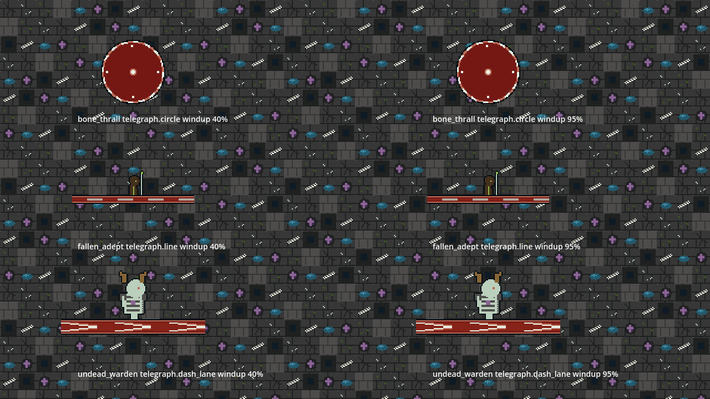
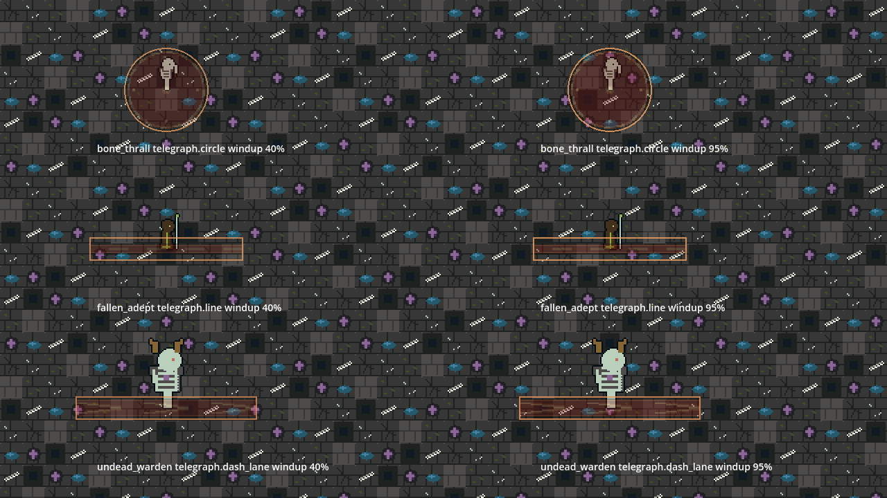
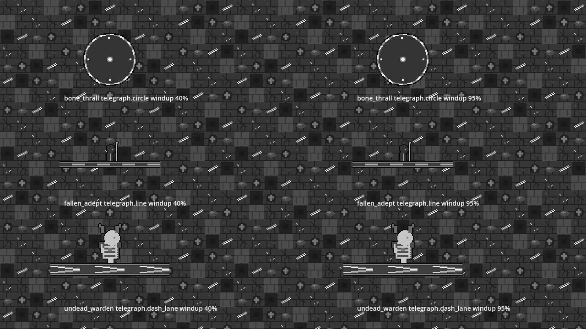
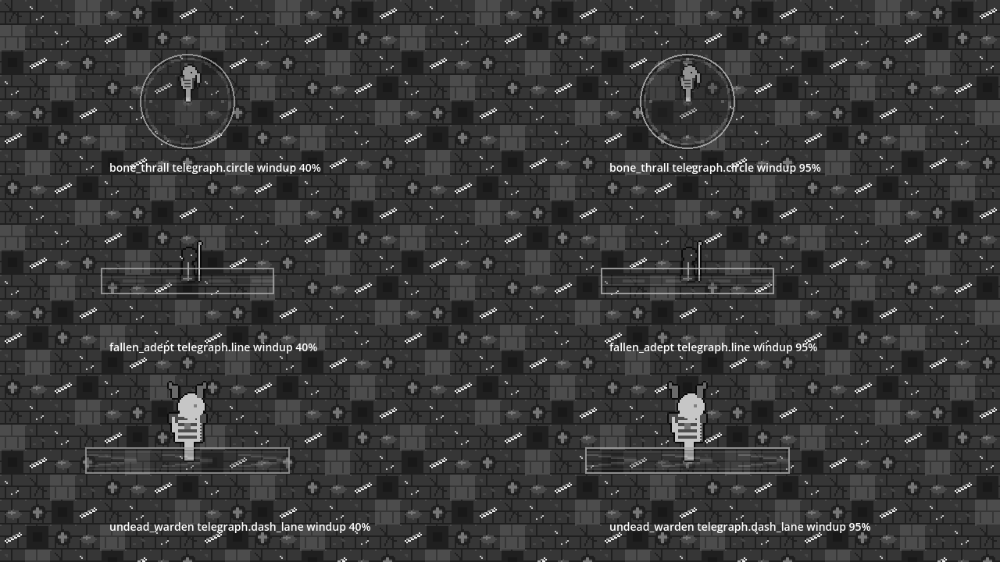
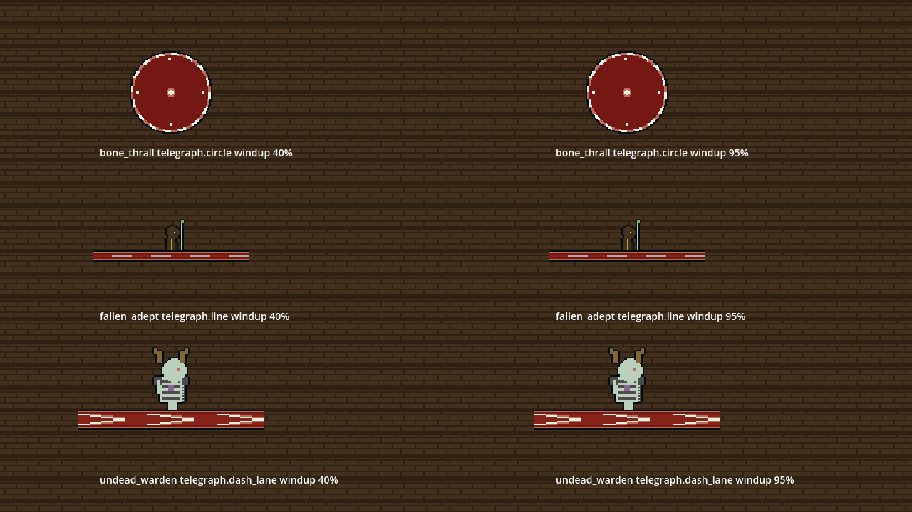
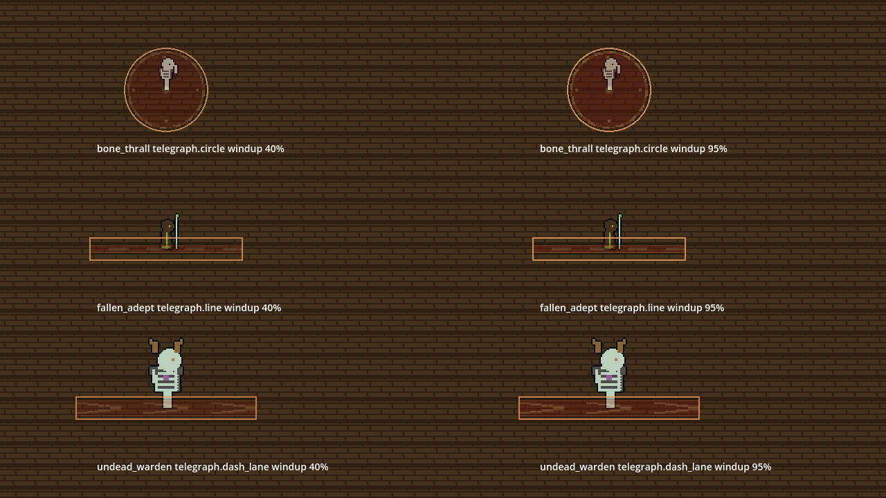
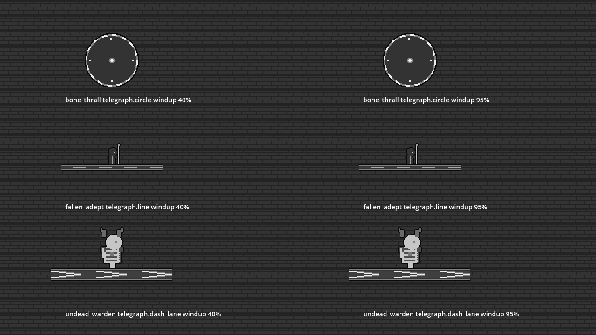
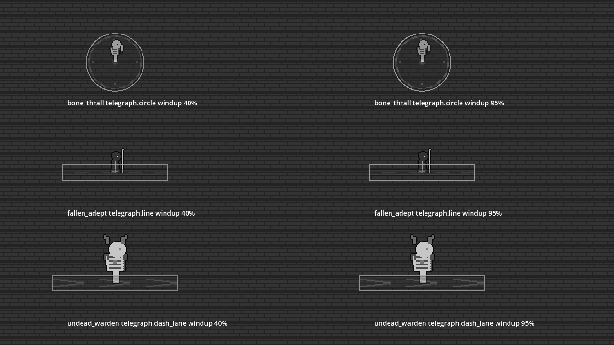

# Enemy telegraphs: softer alpha and colour (AD-088)

Franklin playtest feedback (b): enemy telegraph colours were too strong and opaque. **All values below are [PROPOSED FOR PROTOTYPE]; game-design judges feel in review.**

## What changed
- Telegraph presentation now comes from data: `world/data/presentation_v1.json`, block `telegraph_style`, one entry per event (`telegraph.circle`, `telegraph.line`, `telegraph.dash_lane`).
- Fields: `fill_alpha`, `outline_alpha`, `tint` (warm danger, no pure red) and `pulse` (`start`, `fill_alpha_peak`, `outline_alpha_peak`).
- Drawing: `Art.telegraph_colors` and `Art.draw_fx(..., window)` in `ui/pixel_art_renderer.gd` draw a soft fill plus an outline. Both swell over the last 25% of the windup (`pulse.start` 0.75).
- Design ranges (enforced by `tests/test_ad_telegraph_style.gd`): fill alpha 0.25-0.35, outline alpha 0.70-0.85.

## Reduce-flash
Telegraphs are never suppressed by reduce-flash (`ui/reduce_motion.gd` passes them through unchanged). The swell is a monotonic ramp, not a flash or oscillation.

## Regenerate the shots
```
# after (this branch)
xvfb-run -a godot --path . --script res://tests/capture_ad_telegraphs.gd -- docs/ui/telegraphs/after
# before (origin/master: copy the script into a worktree first)
git worktree add /tmp/ad088_before origin/master
cp tests/capture_ad_telegraphs.gd /tmp/ad088_before/tests/
godot --headless --path /tmp/ad088_before --import
xvfb-run -a godot --path /tmp/ad088_before --script res://tests/capture_ad_telegraphs.gd -- $PWD/docs/ui/telegraphs/before
git worktree remove --force /tmp/ad088_before
```
Each image shows circle (bone_thrall), line (fallen_adept) and dash lane (undead_warden) at 40% (left) and 95% (right) of a 60-tick windup.

## Before / after
| Floor | Before | After |
|---|---|---|
| Ruins |  |  |
| Ruins, greyscale |  |  |
| Workshop |  |  |
| Workshop, greyscale |  |  |
